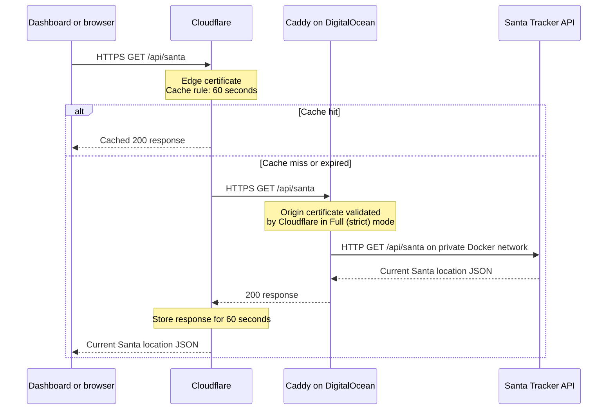
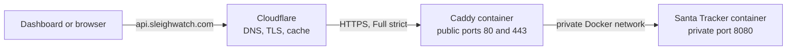

# ADR: Serve the public API through Cloudflare and Caddy

**Date:** 2026-10-14  
**Status:** Accepted

## Context

SleighWatch provides a small public endpoint at `https://api.sleighwatch.com/api/santa`.
Most displays only need to refresh the Santa location once per minute. The API runs on a
DigitalOcean droplet in Docker and should not expose the application container directly to
the public internet.

We need a setup that provides a friendly hostname, HTTPS, protection from repeated requests,
and a simple deployment path for a small project.

## Decision

- Cloudflare manages the `sleighwatch.com` DNS zone and proxies `api.sleighwatch.com`.
- Cloudflare provides the public-facing TLS certificate and caches only
  `api.sleighwatch.com/api/santa` for one minute.
- Caddy runs as a Docker container on the droplet. It obtains and renews an origin TLS
  certificate for `api.sleighwatch.com` and reverse-proxies requests to the API.
- The Santa Tracker container is on the same private Docker network as Caddy and listens on
  port `8080` without publishing that port on the droplet.
- Cloudflare SSL/TLS encryption mode is **Full (strict)**, so Cloudflare validates Caddy's
  certificate before sending a request to the origin.
- Swagger, test, and future health endpoints do not match the cache rule.

## Request and response flow

## Deployment layout

The Docker Compose and Caddy configuration live in [`deploy/`](../deploy/).

## Consequences

- Repeated client polling is served from Cloudflare rather than the droplet for up to one
  minute.
- The API remains a public, no-key endpoint while gaining a practical layer of protection from
  normal accidental over-polling.
- The droplet must keep ports 80 and 443 reachable so Caddy can serve traffic and renew its
  certificate.
- The direct `:8080` endpoint is no longer available after deployment through Compose.
